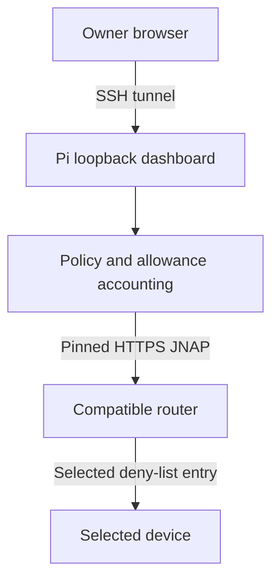

# NetTime

Public release **1.0.0**. See [release numbering](docs/RELEASING.md).

Per-device internet allowances for a home network, with a local Raspberry Pi controller and a browser-based schedule planner.

## What it does

- Set a different allowance for each day of the week.
- Add scheduled exceptions, such as an online class, that do not consume the allowance.
- Grant extra time for the current day or pause leisure access.
- Apply a deny-list rule to one selected device through a compatible router.
- Keep credentials and usage records on the controller, with access through an SSH tunnel.

There are two independent interfaces. The **web planner** runs entirely in the browser, stores settings in localStorage and previews policy decisions. It does not contact a router or measure real usage. The **Pi dashboard** belongs to the Python service and controls the router. Export a schedule from the planner and import it into the Pi dashboard to transfer it.

## Try the planner

Requires Node.js 22.12 or newer and npm. No account, API key, router or Raspberry Pi is needed.

```bash
git clone https://github.com/polarvapourer/NetTime.git
cd NetTime
npm ci
npm run dev
```

Open the local URL printed by Vite. Visit **Schedule**, choose an allowance for every day and save. Open **Preview** to try an exhausted allowance, a scheduled exception or a paused schedule. All values are examples you enter yourself.

```bash
npm test
npm run typecheck
npm run build
npm run preview
```

The production planner is a static site in `dist/`. A host must serve `index.html` for application routes such as `/schedule` and `/preview`.

## Install the controller

Follow the [Raspberry Pi setup guide](docs/SETUP.md). It covers headless Wi-Fi setup, router compatibility, installation, selecting a device, checking enforcement, updates and recovery.

The controller requires Python 3.7+ and uses only the standard library. Use a currently supported Raspberry Pi OS for a new installation. The adapter was tested with a Linksys/Community Fibre M60CF-EU router; other firmware and router models require separate validation.

Build a portable controller package with:

```bash
python3 scripts/build_pi_zip.py
```

The generated `public/downloads/nettime-pi-1.0.0.zip` contains the controller, its tests and setup instructions. It contains no saved configuration. The public package uses generic examples; it is separate from existing private installations.

## How it works



The Python engine polls the router's device list, evaluates the schedule and reads back any rule change. The TypeScript planner has a matching pure policy implementation. Both use Europe/London calendar time, including BST/GMT transitions.

**Allowance means connected-and-allowed time.** An idle device can consume its allowance. This is not screen time, app usage measurement or per-site filtering. Usage resets at London midnight; gaps while the controller is stopped or the router is unreachable are not back-filled.

## Engineering decisions

- **Loopback dashboard:** the controller listens on `127.0.0.1`; SSH provides remote access without exposing a new LAN or internet service.
- **Certificate pinning:** router credentials are sent only after the TLS certificate matches the saved pin. Initial setup still requires the owner to verify the router they are trusting.
- **Scoped changes:** the adapter requires Deny mode and preserves unrelated entries. It refuses infrastructure devices as targets.
- **Uncertain writes:** changes are read back. An unclear result pauses automation instead of repeating a write blindly.
- **External changes:** another administrator's change pauses automation. Switching automation off removes only a block the controller owns.
- **Separate policy code:** date boundaries, exceptions, bonus expiry and validation can be tested without a live router.

See [architecture and limitations](docs/ARCHITECTURE.md) and [privacy and local data](SECURITY.md).

## Verification

```bash
cd controller
python3 -m unittest discover -s tests
```

The automated suite uses synthetic router responses and clocks. It covers allowance boundaries, midnight and DST, exception precedence, device selection, authentication, certificate checks, external edits, uncertain writes and service packaging.

The original controller's block and restore path was also checked manually on one compatible home router with a test device. That does not establish compatibility with every firmware or client. The sanitised public distribution is validated with automated tests; users must perform the documented local device test before relying on enforcement.

## Scope

This is a portfolio project and an experimental home-network tool. It depends on the Pi remaining powered and connected, a stable client Wi-Fi address and the router's local API. A changed MAC address, another network or mobile data can bypass the rule. It does not provide a Wi-Fi extender or a universal parental-control service.

## Repository layout

| Path | Purpose |
| --- | --- |
| `src/lib/nettime/` | Typed policy, validation and browser persistence |
| `src/routes/` | Planner, schedule editor and policy preview |
| `controller/nettime/` | Scheduler, JNAP adapter, local HTTP service and storage |
| `controller/tests/` | Router, security, policy and installation regression tests |
| `scripts/build_pi_zip.py` | Reproducible controller package builder |
| `docs/` | Setup, architecture and example screenshots |
